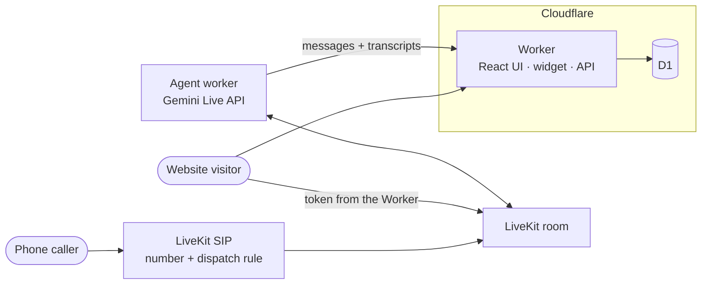

# Sabith's AI Voice Assistant

[](https://github.com/s4b11/livekit-ivr/actions/workflows/ci.yml)

A personal AI assistant for [Sabith S B](https://sabithsb.fermyon.app/). It answers
his calls, introduces who he is and what he builds, and takes messages - in
**English only**, as a real-time speech-to-speech conversation.

One agent, four ways to reach it:

- **Phone** - a LiveKit phone number routes inbound calls to the agent over SIP.
- **Web app** - a React voice UI with LiveKit's Aura visualizer and mute, chat, and end controls.
- **Web widget** - one `<script>` tag adds a voice and text chat bubble to any site.
- **Any LiveKit client** - request a token and join from web, mobile, or another voice app.

The agent runs on **LiveKit Cloud**. Everything a browser touches - the web app,
the widget, the token endpoint, and stored transcripts and messages - runs on
**Cloudflare** (Workers + D1).

## Architecture



| Path | What it is |
| --- | --- |
| `src/voice_assistant/profile.py` | Everything the assistant may say about Sabith. Edit this to change what it knows. |
| `src/voice_assistant/agent/` | The LiveKit agent: prompt, tools (`take_message`, `end_call`), Gemini Live model, worker entrypoint. |
| `src/voice_assistant/telephony/` | One-off script that rents a phone number and creates the SIP dispatch rule. |
| `web/src/` | React voice UI (Vite, Tailwind, shadcn, LiveKit Agents UI). |
| `web/worker/` | Cloudflare Worker: LiveKit tokens, plus transcript and message storage in D1. |
| `web/public/embed/` | The one-tag embed widget and its demo page. |
| `contract/` | The payload the agent sends the Worker, tested from both sides. |
| `.github/workflows/` | CI on every push and PR; deploy to Cloudflare and LiveKit Cloud from `main`. |

More detail: [architecture](docs/architecture.md) · [deployment and secrets](docs/deployment.md) · [embedding](docs/embedding.md)

## Deploy

Pushing to `main` runs CI, then deploys the Worker to Cloudflare and the agent to
LiveKit Cloud. It needs **seven GitHub secrets and nothing else** - no `.env`, no
manual database or agent setup. They are listed in
[docs/deployment.md](docs/deployment.md#github-secrets).

## Local development

Requirements: [uv](https://docs.astral.sh/uv/), Node.js 22, a
[LiveKit Cloud](https://cloud.livekit.io) project, and a
[Gemini API key](https://aistudio.google.com/apikey).

```bash
uv sync
cp .env.example .env                    # agent settings
cp web/.dev.vars.example web/.dev.vars  # Worker secrets
```

Fill in the LiveKit and Gemini keys in both files, then start the web side. One
dev server runs the React app and the Worker, with a local D1 database:

```bash
cd web && npm install && npm run db:migrate:local && npm run dev
```

In a second terminal, start the agent:

```bash
uv run python -m voice_assistant.agent.worker dev
```

Open <http://localhost:5173/> for the voice UI, or
<http://localhost:5173/embed/> for the widget demo.

The agent also runs on its own: leave `BACKEND_BASE_URL` empty and it skips
transcript storage and writes any messages it takes to its log.

## Connect a phone number

```bash
uv run python -m voice_assistant.telephony.provision
```

This rents a US number through LiveKit Phone Numbers (needs the
[`lk` CLI](https://docs.livekit.io/reference/developer-tools/livekit-cli/), signed in)
and creates a dispatch rule that sends every inbound call to the agent.

## Embed on a website

```html
<script src="https://YOUR-WORKER-HOST/embed/embed.js" defer></script>
```

See [docs/embedding.md](docs/embedding.md) for options and for using the token
endpoint from your own client.

## Tests

```bash
uv run ruff check . && uv run ruff format --check . && uv run pytest
```

```bash
cd web && npm run lint && npm test && npm run build
```

The Worker tests run inside the Workers runtime against a local D1 database.
The agent's behaviour tests need LiveKit credentials (they run the agent against
a text LLM through LiveKit Inference) and are skipped without them.

## License

[MIT](LICENSE)
