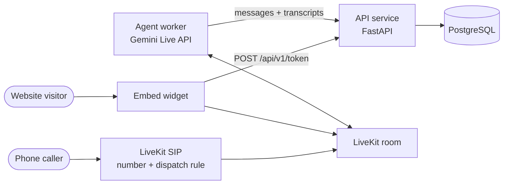

# Sabith's AI Voice Assistant

[](https://github.com/s4b11/livekit-ivr/actions/workflows/ci.yml)

A personal AI assistant for [Sabith S B](https://sabithsb.fermyon.app/). It answers
his calls, introduces who he is and what he builds, and takes messages - in
**English only**, as a real-time speech-to-speech conversation.

One agent, three ways to reach it:

- **Phone** - a LiveKit phone number routes inbound calls to the agent over SIP.
- **Web app** - a React voice UI with LiveKit's Aura visualizer and mute, chat, and end controls.
- **Web widget** - one `<script>` tag adds a voice and text chat bubble to any site.
- **Any LiveKit client** - request a token from the API and join from web, mobile, or another voice app.

## Architecture



| Path | What it is |
| --- | --- |
| `src/voice_assistant/profile.py` | Everything the assistant may say about Sabith. Edit this to change what it knows. |
| `src/voice_assistant/agent/` | The LiveKit agent: prompt, tools (`take_message`, `end_call`), Gemini Live model, worker entrypoint. |
| `src/voice_assistant/api/` | FastAPI service: embed tokens, the widget, and transcript and message storage. |
| `web/` | React voice UI (Vite, Tailwind, shadcn, LiveKit Agents UI). |
| `src/voice_assistant/telephony/` | One-off script that rents a phone number and creates the SIP dispatch rule. |
| `tests/` | Unit, API + PostgreSQL integration, and LLM-judged behaviour tests. |
| `.github/workflows/` | CI on every push and PR; deploy to LiveKit Cloud from `main`. |

More detail: [architecture](docs/architecture.md) · [deployment and CI/CD](docs/deployment.md) · [embedding](docs/embedding.md)

## Quick start

Requirements: [uv](https://docs.astral.sh/uv/), Docker (for PostgreSQL), a
[LiveKit Cloud](https://cloud.livekit.io) project, and a
[Gemini API key](https://aistudio.google.com/apikey).

```bash
uv sync
cp .env.example .env        # then fill in the LiveKit and Gemini keys
docker compose up -d        # PostgreSQL on localhost:5433
```

Run the API service and the agent in two terminals:

```bash
uv run uvicorn voice_assistant.api.app:app --port 8000
```

```bash
uv run python -m voice_assistant.agent.worker dev
```

Then start the web UI in a third terminal and open <http://localhost:5173/app/>:

```bash
cd web && npm install && npm run dev
```

The one-tag widget has its own demo page at <http://localhost:8000/embed/>.

The agent also runs on its own: leave `BACKEND_BASE_URL` empty and it skips
transcript storage and writes any messages it takes to its log.

## Connect a phone number

```bash
uv run python -m voice_assistant.telephony.provision
```

This rents a US number through LiveKit Phone Numbers (needs the
[`lk` CLI](https://docs.livekit.io/reference/developer-tools/livekit-cli/), signed in)
and creates a dispatch rule that sends every inbound call to the agent.

## Embed on a website

```html
<script src="https://YOUR-API-HOST/embed/embed.js" defer></script>
```

See [docs/embedding.md](docs/embedding.md) for options and for using the token
endpoint from your own client.

## Tests

```bash
uv run ruff check . && uv run ruff format --check .
uv run pytest
```

```bash
cd web && npm run lint && npm run build
```

The API tests need PostgreSQL; the behaviour tests need LiveKit credentials
(they run the agent against a text LLM through LiveKit Inference). Each group is
skipped automatically when its dependency is missing.

## Deploy

Pushing to `main` runs CI and then deploys the agent to LiveKit Cloud. The
one-time setup is in [docs/deployment.md](docs/deployment.md).

## License

[MIT](LICENSE)
